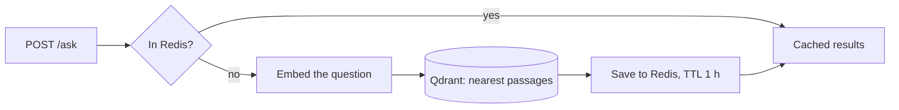

# Lorebase

[](https://github.com/Fahminurs/lorebase/actions/workflows/ci.yml)

A small semantic search service: the **retrieval step of RAG** (Retrieval-Augmented Generation). Ask a question, and Lorebase returns the passages of a knowledge base that match its *meaning*, with a similarity score. Answers to repeated questions are cached.

**Stack:** FastAPI · Qdrant (vector database) · Redis (cache) · fastembed (local multilingual embeddings) · Docker Compose · pytest · GitHub Actions · Jupyter

## How it works



Indexing runs once: `data/knowledge.md` is split into chunks, embedded, and stored in Qdrant. The API builds the index by itself on first start.

## Quick start

```bash
docker compose up --build
```

Then open <http://localhost:8000/docs>, or:

```bash
curl -X POST localhost:8000/ask -H "Content-Type: application/json" \
     -d '{"question": "What is a vector database?", "top_k": 3}'
```

The same question asked twice returns `"cached": true` the second time, and much faster. Indonesian questions work too (`"Apa fungsi Redis?"`), because the embedding model is multilingual.

## API

| Method | Path | Description |
|---|---|---|
| POST | `/ask` | `{"question": str (1-500 chars), "top_k": int (1-10, default 3)}` returns `results`, `cached`, `elapsed_ms` |
| GET | `/health` | Redis and Qdrant status. Returns 503 if the vector store is unreachable |

## Run locally (without the API container)

```bash
docker compose up -d redis qdrant
python -m venv .venv && .venv\Scripts\activate      # source .venv/bin/activate on Linux/macOS
pip install -r requirements.txt
python -m app.ingest                                 # optional: the API indexes on first start
uvicorn app.main:app --reload
```

Configuration is read from environment variables: `QDRANT_URL`, `REDIS_URL`, `CACHE_TTL`, `HF_HOME`, `KNOWLEDGE_PATH`. See `app/config.py`.

## Tests

```bash
pip install -r requirements-ci.txt
pytest -q
```

The API tests use fake Redis, Qdrant and embedder (FastAPI dependency overrides), so they run without any service or model download. They also cover the cache hit, input validation, a vector-store outage (503), and Redis being down (the API keeps working without the cache).

## Notebook

`explore.ipynb` walks through chunking, embeddings, vector search and the cache step by step.

## Project layout

```
app/
  config.py   settings from environment variables
  core.py     pure functions: chunk_text, cache_key
  ingest.py   split -> embed -> store in Qdrant
  main.py     FastAPI app, dependencies, /ask and /health
data/knowledge.md   sample knowledge base
tests/              unit and API tests
Dockerfile, docker-compose.yml, .github/workflows/ci.yml
```

## Scope and next steps

Lorebase covers retrieval only. It does not call an LLM. A natural next step is to pass the returned passages to a model to write the final answer, and to add authentication to `/ask`.

## License

MIT
